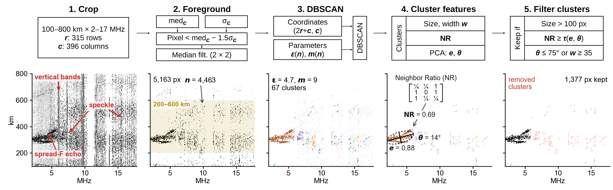
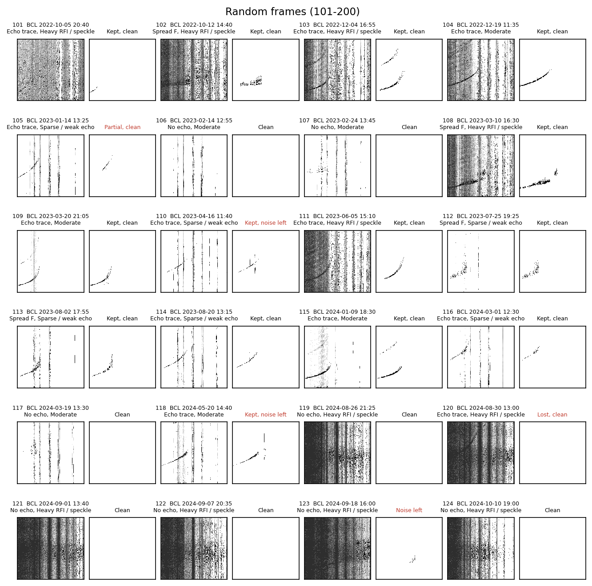

# Denoising Low-Latitude Ionograms Without Losing Spread-F Echoes


This is a heuristic denoiser designed to remove noise from the ionogram images of the SEALION network of NICT. Spread-F cases were especially considered during the design process. The variety of cases where the denoiser works, and its failure modes, are discussed in the [arXiv paper]().


*Steps of the denoiser on a spread-F frame (CPN 2025-08-23 15:05 UTC).*

### Usage

| File                          | Content                                                                                 |
| ----------------------------- | --------------------------------------------------------------------------------------- |
| [`denoiser.py`](denoiser.py) | `load_crop(png)` reads a raw ionogram, `denoise(crop)` returns the echo mask        |
| [`utils.py`](utils.py)       | denoises the 200 frames, builds Table I, draws the example sheets (`python utils.py`) |

```bash
git clone https://github.com/Mert-chan/ionogram-denoiser.git
cd ionogram-denoiser
python -m venv .venv            # Python 3.12
source .venv/bin/activate       # Windows: .venv\Scripts\activate
pip install -r requirements.txt
```

```python
from denoiser import load_crop, denoise
mask = denoise(load_crop("data/raw/CPN_20250823150500.png"))   # True = echo
```

On average, the denoiser takes 36 ms per frame (Intel Core i7-6800K).


*Random frames 101-124: raw and denoised pairs with their grades.*

### Data

SEALION ionograms are available from NICT at https://aer-nc-web.nict.go.jp/sealion/ subject to the SEALION data policy.

### Acknowledgment

The CPN and BCL ionosondes are operated by NICT, Japan, within the SEALION network, in collaboration with KMITL, Thailand, and IES-VAST, Vietnam.
